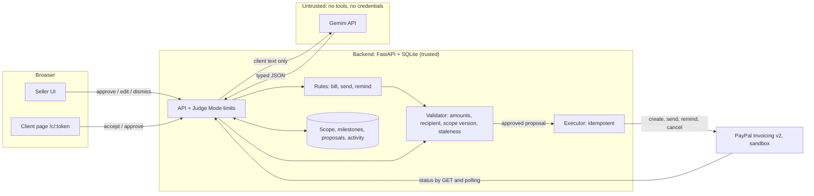

# CreatorMilestone

**When a client asks for one more change, CreatorMilestone's AI checks the request against the scope both sides agreed to, prices the extras from the artist's rate card, and turns what both approve into a PayPal invoice.**

It is a back office for independent artists who take commissions from clients abroad: it also turns a messy client chat into a scope both sides accept, and bills each stage with PayPal invoices that the artist approves.

**Live demo (PayPal sandbox only, no real money): <https://creator-milestone.onrender.com>**

Built for the PayPal AI Hackathon 2026. The AI interprets the request, rules propose the invoice, the seller approves, and the backend calls PayPal Invoicing v2. The model cannot execute PayPal writes, and every charge is computed by code.

> The demo runs on a free host that sleeps when idle. The first load can take about a minute; the page shows a "waking up" notice and retries by itself.

## Try it in 60 seconds

1. Open <https://creator-milestone.onrender.com> and click **Try the demo**. You get your own seeded project (Jiwoo, a Korean illustrator, with a US client). Other visitors cannot see it.
2. **See the AI read a client message.** On the intake screen, use the **Paste example** button, then **Analyze**. The agent lists each term with the words it relied on, flags what is unclear ("Maybe two rounds of revisions?" is marked as needing confirmation, usage rights and the client email as unknown) and drafts a reply in English with a Korean translation. (Tested languages: English and Korean.)
3. **Skip ahead.** On the project screen, use the Judge Mode shortcut **Jump to: deposit paid**. It fills sample terms, records both acceptances, and adopts a real, previously paid sandbox invoice. This reuses an earlier sandbox payment; it does not pay the current invoice (see [limitations](#limitations)).
4. **Catch scope creep.** Go to **New message**, paste the follow-up example, and run it. The AI compares the request with the agreement and cites a clause; code prices the extras from the seller's rate card and creates a change-order proposal for the seller to review. Open the client page link on the project screen (it is mobile-first) to approve it as the client.
5. **Bill.** Approving the billing card creates a real draft invoice in the PayPal sandbox, then a second approval sends it. This creates a real sandbox invoice and is limited per visitor, so skip it if you only want to look. To pay, log in as the sandbox buyer. The Official Rules require testing instructions to include the sandbox login needed to test, so the login is in the Devpost submission's testing instructions and deliberately not in this repository or the app. **You can see the paid state without logging in:** the **Jump to: deposit paid** shortcut from step 3 reuses an earlier sandbox payment. It does not pay the invoice you just created; to see a real payment of a new invoice, pay it as the sandbox buyer.

The demo makes real calls to an AI service. If that free tier is exhausted or unavailable, the two example messages are served from a recorded analysis and the screen says so with a "Cached analysis" label. Any other message then gets a clear error.

## The problem

Commission artists already write terms of service to head off "just one more change". Published terms and guides cover the same ground again and again: revision limits ("one major revision before line art, then minor only"), extra fees for additions (for example $15 per extra revision), commercial use priced separately (1.5x to 2x the base price), and a deposit before work starts. A guide to commission terms names scope creep, ghosting, chargebacks, and surprise usage such as merchandise as the problems those terms exist to prevent. Sources: [Don Corgi](https://doncorgi.com/blog/art-commission-terms-of-service/), [Artists Aware](https://artistsaware.com/art-commissions/sample-tos-detailed/), and artists' own pages such as [cjkkjh](https://www.cjkkjh.com/commissions-terms-and-conditions) and [tapirclip](https://tapirclip.substack.com/p/tos). More, with caveats, in [docs/problem-research.md](docs/problem-research.md).

What this shows: the structure we model (deposit, staged payments, revision limits, priced extras, a separate license) is how artists already work. What it leaves open: those terms sit in a document the client may not read, while the actual agreement happens in a chat, often across languages, and enforcement happens by message. Korean artists on public posts also describe friction in taking commissions directly from overseas clients.

**Our hypothesis, not a finding:** artists would use a tool that checks a later request against the terms both sides agreed to and prices the extras. We did not interview artists and have no usage or willingness-to-pay data. Scope creep may not be the top pain either (the same sources rank ghosting, chargebacks, and scams alongside it, and this tool prevents none of those), and for very small commissions the extra steps may not be worth it. Existing platforms such as VGen already offer commission workflows (see How this differs).

CreatorMilestone is built around one seller (the artist) and one client at a time. It is not a marketplace and not escrow.

## Agree → Bill → Guard

| Stage | What the agent does | Uses the AI model? |
|---|---|---|
| **Agree** | Extracts the scope from a pasted client message. Every field is labeled explicit, inferred, needs-confirmation, or unknown, with a source quote that the server verifies is really in the message. Drafts a clarifying reply plus a translation for the seller (English and Korean are the tested languages). A verified quote shows where the words came from; it does not show that the interpretation is correct, so the seller reviews every field. The seller edits the scope, and both seller and client accept it (the client on a read-only page at `/c/:token`). | Yes, for extraction and the reply text. Quote checking and hedge detection are code. |
| **Bill** | Splits the price into milestones (default 30% / 30% / 40%, stored as 3,000 / 3,000 / 4,000 basis points, exact integer math). When a milestone is due, the rules propose a PayPal invoice with the agreed terms inside it. The seller approves, then approves sending. Status is read back from PayPal. | No. Rules only. |
| **Guard** | Compares a new client message with the agreed scope. Classifies each request (in scope, exceeds limit, out of scope, question), cites the clause, and prices the billable ones from the seller's rate card. The client approves the change order, and that creates scope v2 and an extra invoice. | Yes, to classify, pick a rate-card code and quantity, and draft the reply. Code computes every amount; the model is not sent rate-card prices and never calculates invoice amounts. The seller reviews the result. |

## How this differs

These are comparisons with each product's own public help pages, not a feature audit. We could not open every page from a script (some returned 403 to automated requests), so we state only what those pages are reported to say and make no claim that any product lacks a feature.

| Alternative | What its public pages say it does | What CreatorMilestone tries to add |
|---|---|---|
| [PayPal Invoicing](https://developer.paypal.com/invoicing/about/) alone | Invoices with reminders, status tracking, and partial payments. We build on it. | Turning a chat into an agreed scope, then matching a later request to that scope before an invoice is drafted. |
| Commission platforms such as [VGen](https://help.vgen.co/hc/en-us/articles/12820045188119-How-does-the-VGen-commission-system-work) and [Ko-fi](https://help.ko-fi.com/hc/en-us/articles/360016170433-What-are-Ko-fi-Commissions) | Artist proposals with scope, timeline and milestone payments (VGen, which [supports PayPal](https://help.vgen.co/hc/en-us/articles/12820094917655-What-are-VGen-s-fees)); artist terms, messaging and direct PayPal payments (Ko-fi). | Works with a conversation that happened elsewhere, instead of on a platform. This is not a marketplace. |
| All-in-one freelancer tools such as [Bonsai](https://help.hellobonsai.com/en/articles/5588945-how-to-set-up-your-account-in-bonsai) and [HoneyBook](https://help.honeybook.com/en/articles/5189729-add-customize-and-share-invoices-in-honeybook) | Proposals, contracts, invoices, and client portals (Bonsai); AI-assisted invoices and [payment schedules](https://help.honeybook.com/en/articles/2418574-edit-your-clients-payment-method-options) (HoneyBook). | A narrow tool for one job: quoted evidence and a priced change order for a pasted request. It has no contracts, portal, or accounting. |
| ChatGPT plus copy and paste | A general assistant can draft or compare text from pasted context. | Persistence and process around the model: scope versions, client acceptance, a rate card that sets prices in code, a seller approval for every PayPal write, and status read back from PayPal. A general assistant can do the reading part; we do not claim otherwise. |

We have not verified that any of these products lacks this exact workflow, and we have not tested with users. Whether artists want it is a hypothesis.

## How PayPal is used

Everything runs against the PayPal **sandbox** (`https://api-m.sandbox.paypal.com`); the configuration accepts no other environment. The backend uses PayPal **Invoicing v2** through its own client (`backend/app/services/paypal_client.py`):

| Purpose | Call |
|---|---|
| Authenticate | `POST /v1/oauth2/token` |
| Create a draft invoice | `POST /v2/invoicing/invoices` |
| Send it to the client | `POST /v2/invoicing/invoices/{id}/send` |
| Read status (polling and on demand) | `GET /v2/invoicing/invoices/{id}` |
| Remind | `POST /v2/invoicing/invoices/{id}/remind` |
| Cancel a sent invoice | `POST /v2/invoicing/invoices/{id}/cancel` |
| Recover from a duplicate invoice number | `POST /v2/invoicing/search-invoices` |

Details that matter, all checked against the live sandbox ([test log](docs/paypal-test-log.md)):

- The **agreed terms travel inside the invoice**: `detail.note` says what the payment covers and which scope version it bills; `detail.terms_and_conditions` holds that version's deliverables, formats, revisions, usage rights, and delivery date. The note and terms were confirmed on the buyer-facing page.
- A change order becomes **one invoice with one line per extra** (for example, extra outfit and extra revision).
- Partial payment is turned off on every invoice.
- A milestone counts as settled only when PayPal reports `PAID` for the invoice. A `MARKED_AS_PAID` status is shown differently and does not settle it.
- PayPal returned `422 DUPLICATE_INVOICE_NUMBER` instead of replaying a repeated create. The app uses a stable invoice number (`CM-<project>-<milestone>-<attempt>`) and looks the invoice up by that number to recover.
- Invoicing must be enabled on the sandbox REST app, or calls return `403 NOT_AUTHORIZED`.
- Webhooks are not implemented (`POST /api/webhooks/paypal` answers 501). Status comes from polling.

## How AI is used

The app calls Google's Gemini API from the backend. Defaults: `gemini-3.5-flash-lite`, with `gemini-3.1-flash-lite` as the fallback model (`backend/app/agent/llm.py`). It is used for three things only:

1. Reading a client message into typed fields (structured JSON output, temperature 0).
2. Drafting the clarifying reply and its translation.
3. Classifying a follow-up message against the agreed scope, and drafting the reply.

The model gets no tools and no credentials. Client text is passed as marked, untrusted input. Whatever it returns is validated against a schema and then checked again by deterministic rules (for example: a quote that is not in the message is dropped and its field becomes unknown; a hedged quote such as "maybe two rounds" is forced to needs-confirmation whatever the model said; reply drafts are checked for stray prices). If the reply drafts fail checks, the app falls back to code templates.

## Who does what

| Step | AI (Gemini) | Rules (code) | People |
|---|---|---|---|
| Read the client chat into scope fields with quotes | Reads and drafts the fields, the clarifying reply, and the translation | Verifies each quote is in the message, forces hedged wording to needs-confirmation, validates the schema | The artist reviews and edits every field; both sides accept |
| Check a later request against the agreement | Classifies each request, cites the clause, picks a rate-card code and quantity, drafts the reply | Computes every amount from the rate card; drops quotes that are not in the message | The artist reviews the change order; the client approves it |
| Invoice and payment | Nothing | Proposes the invoice, validates recipient, amount and scope version, calls PayPal, reads status back | The artist approves creating and sending; the buyer pays |

## What the AI can and cannot do with money

- Amounts are computed by the backend from the milestone plan or from the seller's rate card (Σ unit price × quantity, integer minor units). The model selects rate-card codes and quantities, which the seller must review. It is not sent rate-card prices and never calculates invoice amounts. Client messages can contain amounts (intake extracts a budget), and the model sees those.
- The model never calls PayPal and never holds credentials. Only the backend does. What is guaranteed: the model cannot execute PayPal writes, and every charge is computed by code and approved by the seller. A wrong classification or quantity can still be approved by a person, so the seller has to read each proposal.
- Every PayPal write (create draft, send, remind, cancel) is a **proposal card** that the seller must approve. A deterministic validator re-checks it first: the recipient matches the agreed client email (and the sandbox allowlist in Judge Mode), the amount matches our own rows, the scope version is current, and there is no duplicate active invoice for the milestone.
- An approved proposal runs once. If the scope or the target state changed, it becomes stale and cannot run.

## Architecture



Quote checking only proves the quoted words appear in the message, not that the model read them correctly. The trust boundary is between the model and everything else: model output is data that is validated and re-checked, and only the backend's validator and executor can reach PayPal. More in [docs/architecture.md](docs/architecture.md).

## Run it locally

You need a PayPal Developer account and a Gemini API key.

### PayPal sandbox setup

1. In the PayPal Developer dashboard, create a **sandbox REST app** and copy its client ID and secret.
2. **Enable Invoicing** on that app (app settings, features). Without it, every Invoicing call returns `403 NOT_AUTHORIZED`. If the token still lacks the invoicing scope after you enable it, revoke the cached token with `POST /v1/oauth2/token/terminate`; the next token has the scope.
3. Use a sandbox **Business** account as the seller and a sandbox **Personal** account as the buyer.
4. **The buyer must not be a Korean account if the seller is Korean.** PayPal does not allow transactions between two Korean accounts, and sending fails with `KOREAN_MERCHANT_KOREAN_PAYER_RESTRICTED`. This project was tested with a Korean seller and a US buyer.

### Configure

```bash
cp backend/.env.example backend/.env   # then fill in the PayPal and LLM values
```

Never commit `backend/.env`; it is git-ignored.

### Option A: Docker

```bash
docker compose up --build
# open http://localhost:8000
```

The compose file reads `backend/.env`, so create it first. The Docker image build and the container's `/api/health` response were checked for this README; the full flow with credentials is covered by the test log.

### Option B: uv and npm

```bash
cd backend && uv sync
cd ../frontend && npm ci && npm run build   # the backend serves frontend/dist
cd ../backend && uv run uvicorn app.main:app --port 8000
# open http://localhost:8000
```

For development with hot reload, run the backend on :8000 and `npm run dev` in `frontend/` (Vite on :5173 proxies `/api`).

### Click through without credentials

```bash
cd backend && uv run python -m scripts.dev_fake_paypal --judge
```

This runs the real app against an in-memory fake PayPal. It never reads `.env` and never calls PayPal or the AI provider; the two demo messages return recorded analyses. It is a development aid, not evidence of PayPal behavior.

## Tests

```bash
cd backend && uv run pytest -q          # 471 passed
cd backend && uv run ruff check .       # clean
cd frontend && npm run build            # type-check and build
```

The 471 tests (verified on this commit) use a fake PayPal transport and a fake LLM provider, so they make no network calls. They cover money math, quote verification and hedge detection, state machines, status mapping, proposal staleness and idempotency, Scope Guard classification fixtures, change orders, and Judge Mode isolation and limits. They are not live-PayPal tests. Live behavior is recorded in [docs/paypal-test-log.md](docs/paypal-test-log.md), produced by `backend/scripts/paypal_smoke_test.py` and manual runs. The frontend has one small vitest file for step derivation; nothing tests the UI in a browser.

## Limitations

This is a sandbox hackathon project, not a production service.

- **Sandbox only.** No real money moves. Nothing here is production-ready.
- **Not escrow and not buyer protection.** Acceptance in the demo is a click in a form. It does not verify identity, provide an electronic signature, or claim to be enforceable; we draw no legal conclusions.
- **Languages.** Only English and Korean were tested. Other languages may work but are not evaluated.
- **Privacy.** Pasted client messages are sent to Google's Gemini API. Do not paste real customer data into the public demo.
- **AI quality is measured on a small set.** See [docs/ai-eval.md](docs/ai-eval.md) for 20 labeled cases, what failed, and the limits of that sample.
- **Messages are pasted in.** There is no email, chat, or messaging integration.
- **One seller account.** There is no sign-up or multi-seller authentication; the client acts through an unguessable link.
- **Korean-to-Korean PayPal transactions are not possible.** Use a non-Korean sandbox buyer with a Korean seller.
- **The demo shortcut reuses an earlier sandbox payment and does not pay the current invoice.** "Jump to: deposit paid" does not fake PayPal state. It asks PayPal live and shows "Paid via PayPal" only if a specific, earlier sandbox invoice reads `PAID` for the deposit's amount. Otherwise the project stays in its normal state.
- **Free host.** It can take about a minute to wake, and local data is lost when it restarts (a visitor just gets a fresh seeded project). There is no keep-alive ping.
- **Free AI tier.** When the model service fails or the daily cap for the demo is reached, the two example messages return a recorded (cached) analysis, labeled as such. Other messages get an error.
- **Polling, not webhooks.** Payment status can lag by about the polling interval (20 seconds by default) unless you refresh the invoice.
- Limits (rate limits and daily caps on AI requests and invoices) apply to the hosted demo; see below.
- The PayPal `payment_date_time` field was observed hours off from the send time, so the app orders events by its own sync time.
- A reminder was accepted by PayPal, but whether it reaches the buyer's sandbox inbox was not checked.
- The two-line change-order invoice was created, sent, and paid in the sandbox; its buyer-facing page was not separately inspected for the note and terms. (Confirmed on the one-line invoice.)

## What was built during the hackathon

The whole project was created during the hackathon period: the git history starts on 2026-11-01 and everything in this repository was built after that. It includes the FastAPI backend, the PayPal Invoicing v2 client and sandbox smoke test, the agent (intake, Scope Guard, rules, validator, executor), the state machines and money math, the React single-page app and mobile client page, Judge Mode, the 471 tests, and the design in `design/`. The product decisions and the PayPal and AI trust model are the owner's; AI coding tools wrote much of the code (see Tools).

## Tools

- **Languages and frameworks:** Python 3.12, FastAPI, SQLAlchemy and SQLite, httpx; React 19, TypeScript, Vite, Tailwind CSS, TanStack Query, React Router, lucide icons.
- **PayPal:** Invoicing v2 REST API and OAuth2, sandbox.
- **AI in the product:** Google Gemini API (`gemini-3.5-flash-lite`, fallback `gemini-3.1-flash-lite`) for message analysis, reply drafts, and Scope Guard classification.
- **AI used to build it:** Claude Code (Anthropic models) wrote most of the code and tests; the git history credits it as co-author on 30 commits. Codex (OpenAI) was also used and is credited on one commit. Orca, a multi-agent IDE, coordinated these agents.
- **AI-generated narration:** the demo video's voice-over is generated with Google's Gemini text-to-speech from the script in `docs/narration.txt`; it is not a human voice, and the video says so.
- **AI-generated sample art:** the three demo images in `design/assets/demo-art/` were generated with OpenAI's built-in image generation tool and are AI-generated sample artwork. Prompts are in that folder's README.
- **Design:** the UI was designed in Pencil (`design/creator-milestone.pen`) with exports in `design/screenshots/`.
- **Hosting and CI:** Render (Docker, free plan), GitHub Actions (`.github/workflows/ci.yml`).

## Hosted demo notes (Judge Mode)

`JUDGE_MODE=true` turns the app into the public demo. Each browser gets a signed cookie and its own seeded project; another visitor's project answers 404. The recipient is limited to the configured sandbox buyer. Request rates, AI requests (per visitor, per IP, and a global daily cap), and invoice creation (per visitor per hour and globally per day) are limited, and over-limit answers use a plain error shape. Defaults are in `backend/app/config.py` (`LIMIT_*`). Settings for the hosted instance are in [`render.yaml`](render.yaml); secrets are set in the host dashboard and never committed. The database schema comes from `create_all` with no migrations, so delete any local `creatormilestone.db` after pulling schema changes.

## Repository layout

```text
backend/    FastAPI service, PayPal Invoicing v2 client, agent, smoke test, tests
frontend/   React + TypeScript + Vite + Tailwind single-page app
docs/       PRD, architecture, PayPal sandbox test log, Devpost text, demo script
design/     Design source, exports, implementation screenshots, AI-generated sample art
```

## License

[MIT](LICENSE)
