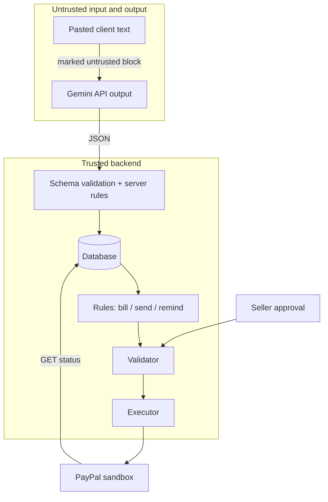

# Architecture

CreatorMilestone is one FastAPI service (API plus the built React app on one origin) with a SQLite database. It has one seller per instance and one client per project, who acts through an unguessable link. This document describes what the code in `backend/app/` does. It is a sandbox hackathon project and makes no production-readiness claims.

## The agent loop

The agent is an event-driven loop with typed output, not a free-form tool-calling bot.

```text
event -> context -> [LLM, only where judgment is needed] -> validation rules
      -> proposal card -> seller approves -> validator re-check -> executor -> PayPal
```

| Event | What the agent produces | Uses the LLM? | Code |
|---|---|---|---|
| Seller pastes a client message at intake | Typed extraction (explicit / inferred / needs-confirmation / unknown, with quotes) and a clarifying reply with a translation | **Yes** | `agent/intake.py` |
| Server checks the extraction | Drops quotes that are not in the message, forces hedged terms to needs-confirmation, normalizes language, checks reply drafts | No (rules) | `agent/intake.py`, `agent/hedging.py` |
| Both parties accept the scope | A proposal to bill the deposit | No (rule) | `agent/rules.py` |
| Client approves a delivery | A proposal to bill that milestone | No (rule) | `agent/rules.py` |
| A draft invoice exists | A proposal to send it | No (rule) | `agent/rules.py` |
| A sent invoice stays unpaid past a threshold (default 60 minutes) | A proposal to send a reminder, with templated text | No (rule, code template) | `agent/rules.py` |
| Client pastes a follow-up message after agreement | Per-request classification (in scope, exceeds limit, out of scope, question), clause citation, rate-card item and quantity, reply draft | **Yes** (classification and reply text) | `agent/scope_guard.py` |
| Server checks the classification | Overrides classifications the rules forbid, computes every amount from the rate card, fills prices into the reply | No (rules) | `agent/scope_guard.py` |
| Client approves a change order | A scope v2 and a proposal to bill the change order | No (rule) | `services/change_orders.py`, `agent/rules.py` |
| PayPal reports `PAID` | The milestone settles and the next one unlocks (logged, not a money action) | No | `services/invoices.py`, `services/invoice_sync.py` |

The model handles language and judgment: it interprets the request, and may select a rate-card code and quantity. Rules propose the invoice and compute every amount, the seller approves, and the backend calls PayPal. The model is not sent rate-card prices, but client messages it reads can contain amounts.

### Proposals

A proposal has a kind (`BILL_MILESTONE`, `SEND_INVOICE`, `SEND_REMINDER`, `CHANGE_ORDER`, `CANCEL_INVOICE`), a typed payload, a one-sentence rationale, evidence, the computed amounts, the scope version it was made for, an idempotency key, and a status: `PENDING`, `APPROVED`, `EXECUTED`, `FAILED`, `DISMISSED`, `STALE`.

- **Approval is claimed atomically** (`agent/executor.py`): one conditional update moves `PENDING` or `FAILED` to `APPROVED`, so only one concurrent approval runs.
- **Stale detection**: if the scope version or the target's state changed since the proposal was made, it becomes `STALE` and cannot run.
- **Failed proposals** keep the PayPal error and can be retried or edited (for example, the recipient), going back through `APPROVED`.
- Allowed transitions are in `services/state_machines.py`; anything else is a 409 `FORBIDDEN_TRANSITION`.

### Validator (deterministic)

Before any PayPal write, `agent/validator.py` checks, against our own database rows and not the proposal payload:

- the recipient equals the agreed client email, and in Judge Mode is on the sandbox allowlist;
- the amount equals the milestone or change-order total the backend computes;
- the commission and target are in a state that allows the action;
- the scope version is current, and there is no duplicate active invoice for the milestone;
- change-order lines are valid rate-card quantities.

## Trust boundaries



1. **Client text is untrusted.** It is passed to the model inside a labeled block, capped in length (6,000 characters), and never used as an instruction by the backend.
2. **Model output is untrusted.** A quote check proves the quoted words appear in the message; it does not prove the model's reading, translation, or clause match is right. It is parsed against a schema, then corrected by rules: quotes must appear in the source, hedged claims are demoted, prices come from the rate card, and amounts mentioned in drafts are checked or replaced by placeholders filled from backend numbers (`fill_tokens`). If a model call fails after retries, the app tries a second model, then a code template for reply text, and for the two demo messages a recorded analysis, labeled as cached.
3. **The model has no tools and no PayPal access.** Only `services/paypal_client.py` holds PayPal credentials.
4. **A human approves every PayPal write.** The seller approves; the validator checks again at execution time.
5. **PayPal owns payment truth.** The app marks a milestone settled only after a `GET` returns `PAID`. It never uses the invoice "record payment" endpoint, which would create `MARKED_AS_PAID`.
6. **Judge Mode** (hosted demo only) adds per-visitor isolation by a signed cookie, a recipient allowlist, rate limits and daily caps on AI requests and invoices, and a request-body cap. Shortcuts never fabricate PayPal state.

What is **not** a boundary: there is no seller authentication in the demo (one seeded seller per visitor), and client acceptance is a click on a link. It does not verify identity or provide an e-signature, and we make no claim about enforceability. A model-selected code or quantity can still be approved by a person; the guarantee is that the model cannot execute PayPal writes.

## Data and state

- **Money** is integer minor units everywhere. The default plan is 3,000 / 3,000 / 4,000 basis points (30% / 30% / 40%) with the remainder on the last milestone ($300.00 gives $90.00, $90.00, $120.00). PayPal amounts are 2-decimal strings.
- **Commission**: `DRAFT`, `AWAITING_ACCEPTANCE`, `AGREED`, `IN_PROGRESS`, `COMPLETED`, `CANCELLED`. Editing an agreed scope bumps the scope version and clears both acceptances.
- **Milestone**: `LOCKED`, `AWAITING_DELIVERY`, `DELIVERED`, `APPROVED`, `READY_TO_BILL`, `BILLED`, `SETTLED`.
- **Change order**: `DRAFT`, `SELLER_APPROVED`, `CLIENT_APPROVED`, `DECLINED`, `SUPERSEDED`. Client approval creates a change-order milestone and scope v2.
- **Activity log** records actor (agent, seller, client, PayPal, system) for each event.
- **Status polling**: an in-process task reads open invoices every 20 seconds by default and on demand. Webhooks are not implemented.

## PayPal behaviors verified against the sandbox

From [paypal-test-log.md](paypal-test-log.md), real calls to `https://api-m.sandbox.paypal.com`:

- **Invoicing must be enabled on the REST app.** Before that, the token had no invoicing scope and calls returned `403 NOT_AUTHORIZED`. After enabling it, PayPal kept returning the cached token; `POST /v1/oauth2/token/terminate` forced a new token with 27 scopes including invoicing.
- **Korean seller plus Korean buyer fails on send** with `406 MEDIA_TYPE_NOT_ACCEPTABLE` and issue `KOREAN_MERCHANT_KOREAN_PAYER_RESTRICTED`. With a US buyer and the same seller, send, remind, and cancel succeeded (14 of 14 smoke steps).
- **Drafts carry `note` and `terms_and_conditions`**, which come back on `GET`. The owner confirmed both on the buyer-facing page.
- **A repeated create with the same `PayPal-Request-Id` and invoice number returns `422 DUPLICATE_INVOICE_NUMBER`** rather than replaying. The app recovers by searching by invoice number.
- **Cancelling a draft returns `422 CANNOT_CANCEL_DRAFT_INVOICE`.** Only sent invoices can be cancelled.
- **Send returns one link** with `rel: payer-view`.
- **Payment read-back**: after the sandbox buyer paid, `GET` returned `status: PAID`, `due_amount: 0.00`, `paid_amount: 90.00` and one `PAYPAL` transaction with `SUCCESS`.
- **`payments.transactions[].payment_date_time` was about 8 hours before the invoice's send time**, so it is not treated as reliable UTC; the app orders events by its own sync time.
- **Full flow** (2026-11-05): analysis, scope, both acceptances, deposit invoice, Scope Guard ($100.00 over two lines), both change-order approvals, scope v2, and the change-order invoice were run against the sandbox through the app's HTTP API with the real model. Both invoices were then paid by the sandbox buyer and read back as `PAID` ($90.00 and $100.00).

### Not verified

- Whether a reminder reaches the buyer's sandbox notifications (PayPal accepted the call).
- The buyer-facing page of the two-line change-order invoice was not separately inspected for note and terms.
- Webhooks and any live (non-sandbox) PayPal behavior.
